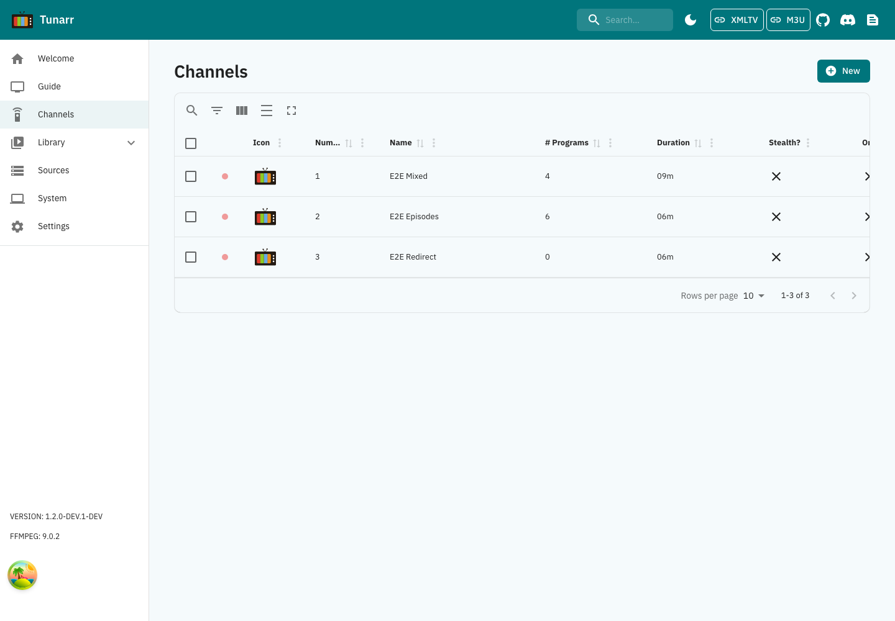

# Channels

Channels are the core of Tunarr. Each channel acts like a virtual TV station with its own programming schedule, stream settings, and EPG data.

Click the **NEW** button to create your first channel, which will take you to the [Channel Properties](properties.md) page.

Save creates the channel and opens its programming page; the fields are locked until it exists. When you edit a
channel, Save is enabled once something has changed, and "Reset changes" puts the saved values back. Switching
between the editor's tabs keeps your changes, and leaving the page with unsaved changes asks first.

The edit tabs are **Properties**, **Flex**, **Guide**, **Streaming**, and **Watermark**. Each has its own address, so you can bookmark or share a tab and use the browser's Back and Forward buttons between tabs. These tab changes keep the same unsaved form; Save applies changes from all tabs together. Older `?tab=epg` and `?tab=ffmpeg` links open Guide and Streaming respectively.

-   **[Properties](properties.md)**

    ---

    Configure basic channel settings like name, number, icon, and group.

-   **[Programming](programming.md)**

    ---

    Add shows, movies, and other content to your channel's schedule.

-   **[Flex](flex.md)**

    ---

    Configure filler content to play during gaps in your schedule.

-   **[Guide](epg.md)**

    ---

    Customize how your channel appears in electronic program guides.

-   **[Transcoding](transcoding.md)**

    ---

    Configure stream modes and transcoding settings per channel.

-   **[Watermarks](watermarks.md)**

    ---

    Add logo overlays and watermarks to your channel's video output.

## Working with several channels

On the Channels page (on a computer; phones show the channel cards without checkboxes), tick the box on each channel
you want, or the box in the header to select the whole page. The table then shows how many are selected and:

- **Delete** asks once, listing the channels, and deletes them all. If some fail, the message names each one that was
  not deleted and why.
- **Hide from guide** and **Show in guide** turn the channel's **Stealth mode** on or off for every selected channel.
  Stealth mode hides a channel from the guide, the HDHomeRun tuner and the M3U playlist; you can still stream it
  directly or redirect to it. Only the channels that need the change are saved, and each keeps its other settings,
  including its filler lists.

The selection clears when the action finishes and when you change page.

## Updating channel relations through the API

`PUT /api/channels/{id}` keeps saved filler attachments and subtitle preferences when
`fillerCollections` or `subtitlePreferences` is omitted. Send an explicit `[]` to clear that
relation, or a nonempty array to replace it. The remaining required channel fields are unchanged.
The channel editor sends a relation only when you edit it, including an empty list when you
remove the last subtitle preference.

## Getting Started

1. Create a new channel with [Properties](properties.md)
2. Add content via [Programming](programming.md)
3. Use [Scheduling Tools](../scheduling/index.md) to organize your lineup
4. Configure a [Client](../clients/index.md) to watch your channel
