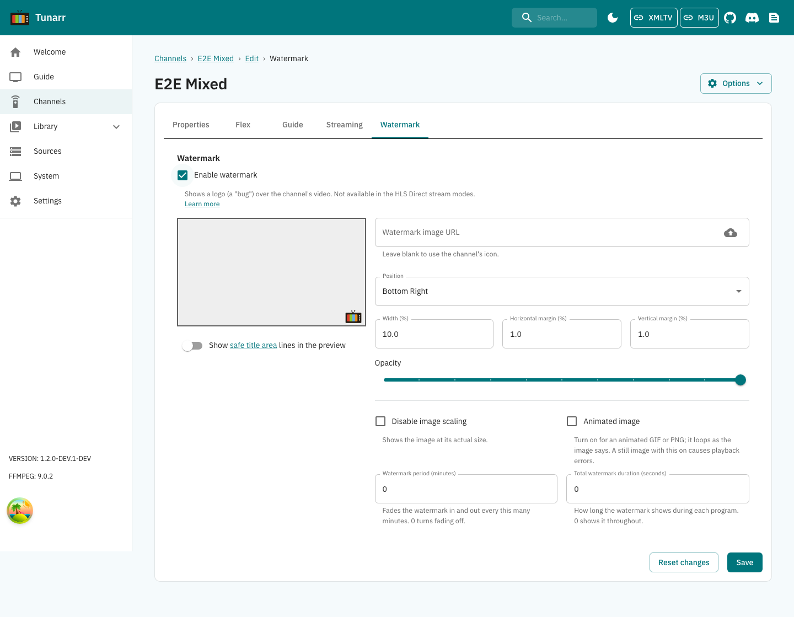

# Channel Watermarks

Channels can have watermarks to aid in recreating a classic TV experience.

Open the channel editor's **Watermark** tab to enable and configure its overlay. These controls are separate from **Streaming**; the HLS Direct stream modes still disable watermarks.

There are many ways to customize watermarks for a channel. Here are some details on specific options:

### Watermark Period

This value can be used to fade a channel's watermark in/out every N minutes.

### Watermark on leading edge

When using intermittent watermarks, use this option to control whether the watermark begins in a visible (true) or hidden (false) state.

### Total watermark duration

This option controls the absolute duration the watermark can be displayed for a given program segment of a channel. Its value takes precedence over the 'watermark period' but does not disable it. For instance, you could configure a watermark period of 5 minutes with total duration of 45 mins. On a show that is one hour, the watermark will fade in/out for the first 45 minutes and then be hidden for the final 15 minutes.

For output resolution, bitrate, and buffer size, choose a [transcode configuration](../ffmpeg/transcode_config.md) on the channel's [Streaming tab](transcoding.md).
