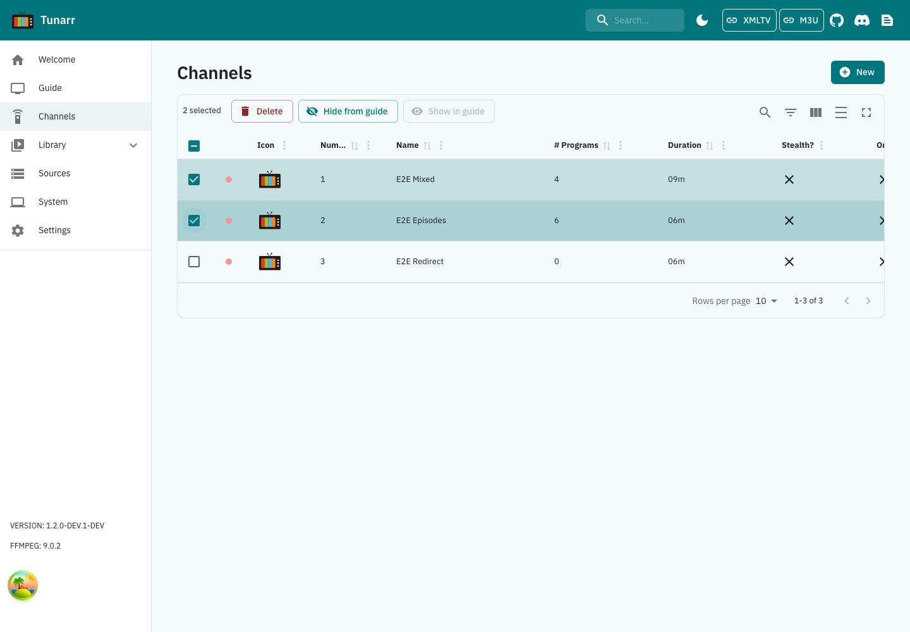
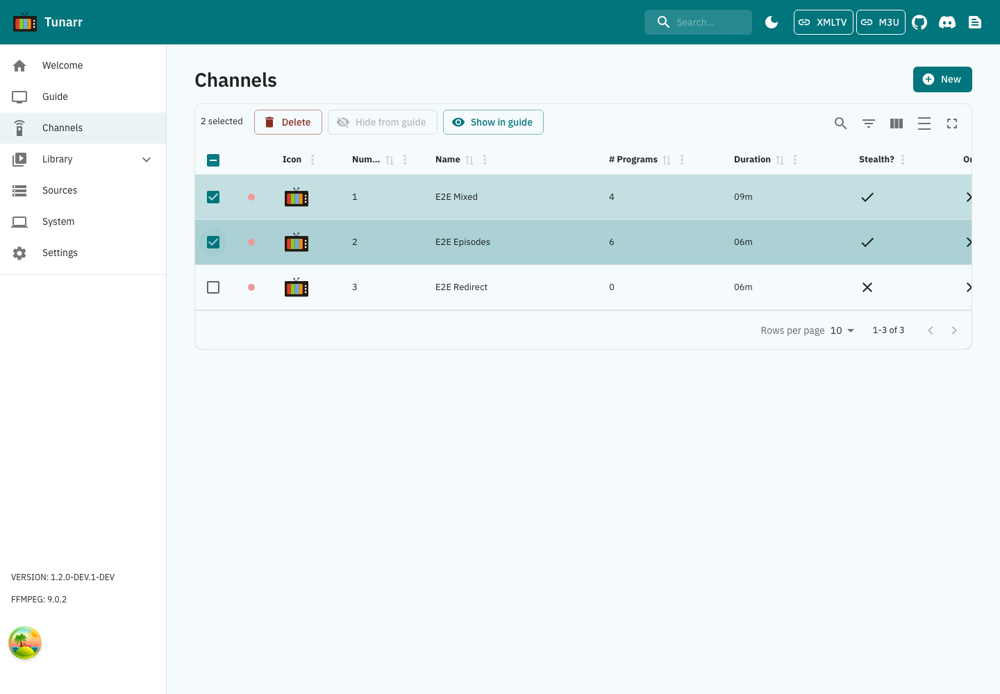
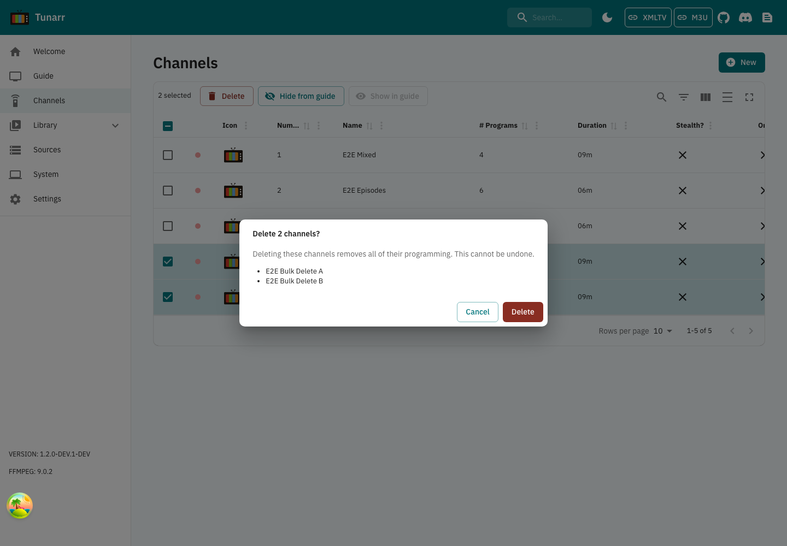
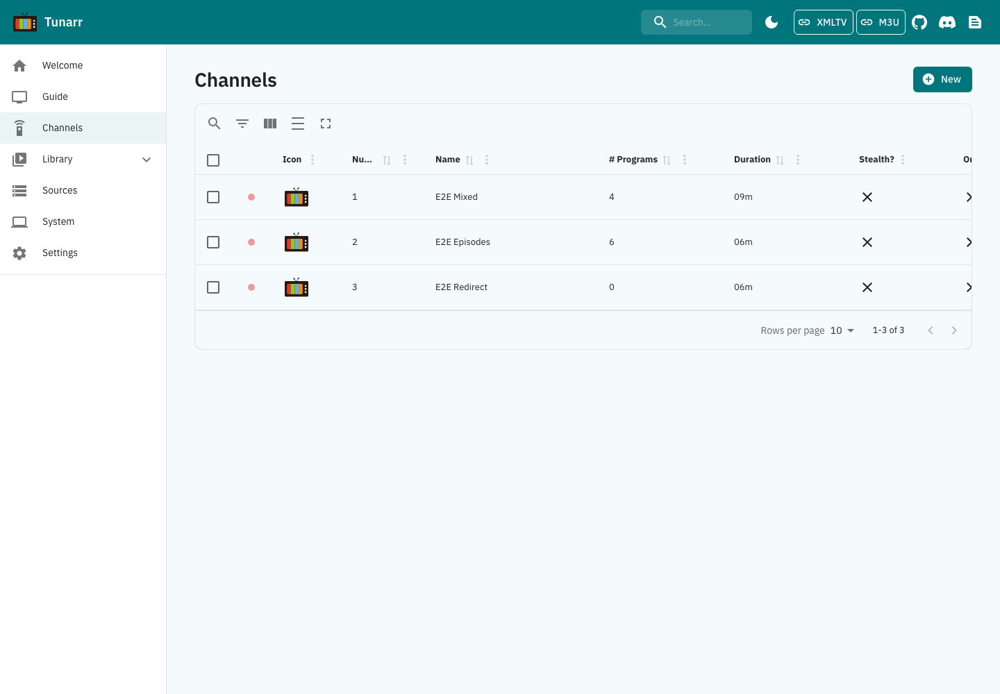

# Channel bulk actions: browser evidence

These 1440px light-theme captures use the generic E2E fixture, with no production
data. They show the same two selected channels before hiding and after reload:
visibility changes, and the toolbar offers the reverse action. The browser test
also verifies M3U output, persisted channel data and one batch request per action.

| Before hiding | After hiding and reload |
| --- | --- |
|  |  |

Recapture with `cd e2e && TUNARR_E2E_PORT_OFFSET=12000 pnpm exec playwright test
tests/channelBulkStealth.spec.ts --workers=1` after the normal E2E setup. The
fixture resets its local database; run it separately from other tests using the
same worktree's `.data` directory. Images are written to that run's test-results.

## Deletion confirmation and result

The deletion case creates two temporary copies of a seeded channel. One named
confirmation removes both through one batch request; reload retains the three
original fixture channels. The browser also verifies deleted-channel 404s and
their removal from M3U. Captures disable animations so the confirmation is fully
visible.

| Before confirming | After deletion and reload |
| --- | --- |
|  |  |

Run `tests/channelBulkDelete.spec.ts` with the same command above, or run both
batch specs together with one worker.
